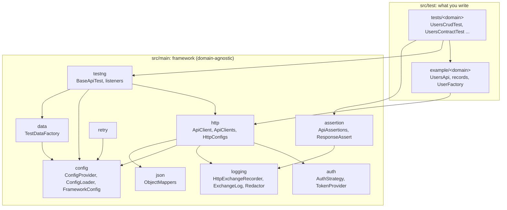
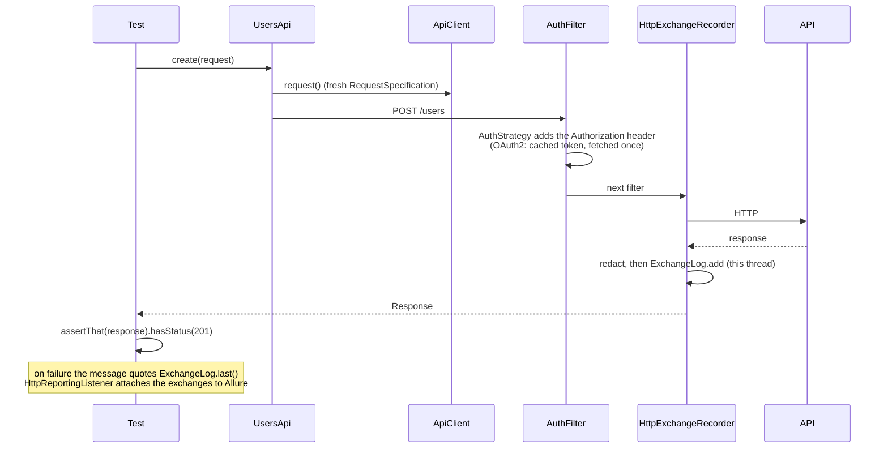

# Architecture

## Layers

Rules:

- **Tests depend on domain clients; domain clients depend on the framework.** Never the reverse.
- `src/main` knows nothing about any API under test. If a class mentions "user", it belongs in `src/test`.
- `config` depends on nothing else in the framework. Everything else may read `FrameworkConfig`.
- Only `http` (and `auth`, through filters) touches REST Assured's request building. Tests talk to domain
  clients, which return the raw `Response` for the test to assert on.

## Packages

| Package | Responsibility | Key types |
|---|---|---|
| `config` | Load, layer, validate and expose configuration; guard secrets | `ConfigKeys`, `ConfigSource`, `LayeredConfig`, `ConfigLoader`, `ConfigProvider`, `FrameworkConfig`, `AuthSettings`, `Secret` |
| `http` | Build the immutable client and per-request specifications | `ApiClient`, `ApiClients.defaultClient()`, `HttpConfigs` |
| `auth` | Apply credentials to a request | `AuthStrategy`, `AuthStrategies`, `AuthFilter`, `BasicAuth`, `ApiKeyAuth`, `BearerTokenAuth`, `TokenProvider`, `CachingTokenProvider`, `ClientCredentialsTokenProvider` |
| `logging` | Capture each exchange, redacted, per thread | `HttpExchangeRecorder`, `ExchangeLog`, `HttpExchange`, `Redactor` |
| `assertion` | Fluent response assertions with useful failure messages | `ApiAssertions.assertThat(Response)`, `ResponseAssert` |
| `retry` | Retry transport failures only | `TransientFailureRetryAnalyzer`, `RetryAnnotationTransformer` |
| `data` | Reproducible, unique test data | `TestDataFactory` |
| `json` | One shared Jackson configuration | `ObjectMappers` |
| `testng` | Test base class and TestNG integration | `BaseApiTest`, `HttpReportingListener`, `ParallelismListener` |

## A request, end to end

## Extension points

| To add | Implement or edit | Notes |
|---|---|---|
| An API under test | a client class like `UsersApi` in `src/test/.../example/<domain>/` | See [WRITING_TESTS.md](WRITING_TESTS.md). |
| An auth scheme | `AuthStrategy`, then a case in `AuthSettings` + `AuthStrategies` + `ConfigLoader` | The `switch` over the sealed `AuthSettings` is exhaustive, so the compiler finds every place to update. |
| A token source | `TokenProvider`, wrapped in `CachingTokenProvider` | The cache handles expiry skew and concurrent callers. |
| A config source | `ConfigSource` (`name()`, `get(key)`, `secretSafe()`), added to `ConfigProvider.layersFor` | Decide `secretSafe` deliberately. |
| A request filter | `apiClient.withFilter(filter)` | Returns a new client; the shared one is unchanged. |
| A per-test client variant | `withAuth(...)`, `withoutAuth()` | Used by the 401 test. |
| A response assertion | a method on `ResponseAssert` | Call the private `failWithContext(format, args)`, which passes your message plus `exchangeContext()` (request and response summary) to `failWithMessage`, so failures stay readable. |
| A TestNG listener | a class in `framework.testng`, listed in `src/main/resources/META-INF/services/org.testng.ITestNGListener` | Test-only listeners go in the `src/test` services file. |

## SOLID mapping

| Principle | Where it shows |
|---|---|
| **Single responsibility** | Loading (`ConfigSource`), precedence (`LayeredConfig`), validation (`ConfigLoader`) and access (`ConfigProvider`) are separate. Capture (`HttpExchangeRecorder`), storage (`ExchangeLog`), masking (`Redactor`) and publishing (`HttpReportingListener`) are separate. |
| **Open/closed** | New auth schemes, token sources, config sources and filters are added by implementing an interface. Existing classes do not change. |
| **Liskov substitution** | Every `AuthStrategy` and `TokenProvider` works wherever the interface is expected. `StaticTokenProvider` and `ClientCredentialsTokenProvider` are interchangeable behind `BearerTokenAuth`. |
| **Interface segregation** | Small interfaces: `AuthStrategy` has one method, `TokenProvider` has `token()` plus a default `invalidate()`, and `ConfigSource` has three methods. |
| **Dependency inversion** | `ApiClient` takes an `AuthStrategy` and a list of filters; it does not build them. `CachingTokenProvider` takes a `Clock`, so tests control time. Unit tests build every piece by hand against their own WireMock server. |

## Design decisions

| Decision | Why | ADR |
|---|---|---|
| Records, no Lombok | Immutable, visible code with no annotation processor | [0001](adr/0001-java-records-over-lombok.md) |
| Own config loader | Provenance, secret rules, clear errors, no abandoned dependency | [0002](adr/0002-hand-written-config-loader.md) |
| Own redacting capture | Nothing unredacted is ever stored or published | [0003](adr/0003-own-redacting-http-capture.md) |
| No global REST Assured state | Parallel-safe, no hidden setup | [0004](adr/0004-no-global-rest-assured-state.md) |
| Surefire 3.5.x | Keeps TestNG suite files | [0005](adr/0005-surefire-3-5-for-testng-suites.md) |
| Retry only on `IOException` | Retries must never hide a real failure | — |
| Offline example via WireMock | Deterministic CI with no external services | — |
| Process-wide config, loaded once | One consistent view per run, logged once | — |

## Thread safety

Tests run with `parallel="methods"`. What makes that safe:

- `FrameworkConfig`, `ApiClient`, `AuthStrategy` and the models are immutable.
- `ExchangeLog`, the `BaseApiTest` cleanup stack and `TestDataFactory.current()` are thread-local.
  `HttpReportingListener` / `BaseApiTest` clear `ExchangeLog` and the cleanup stack after every test
  method. `TestDataFactory.current()` is not cleared: each worker thread keeps one seeded `Faker` for its
  lifetime, and its random sequence continues from one test to the next on that thread.
- `CachingTokenProvider` is synchronised and fetches a token once for all concurrent callers.
- Unique data (`TestDataFactory.uniqueEmail()`, `uniqueSuffix()`) is scoped by a per-run id, so parallel
  tests and parallel CI jobs do not collide.

## Dependency policy

- **Versions** are properties in `pom.xml`. BOMs are imported for Jackson and Allure.
- **Convergence**: the enforcer's `dependencyConvergence` rule fails the build on any transitive
  version conflict. Resolve a conflict with an explicit pin in `<dependencyManagement>`, choosing the newest
  version, with a comment that names who needs it.
- **Scope**: test-only tools (WireMock, Logback) are `test` scope. Runtime framework dependencies are
  kept to what the framework code imports.
- **Adding a dependency** needs a reason in the pull request: what it replaces, how maintained it is,
  and its licence (must be compatible with MIT). Large additions get an ADR.
- **Upgrading**: one library per pull request; read the release notes; run `./mvnw -B verify`.
  Surefire is held on 3.5.x on purpose ([ADR 0005](adr/0005-surefire-3-5-for-testng-suites.md)).
- **Banned**: Lombok, the Owner library, `allure-rest-assured`, and any library that requires mutating
  global REST Assured state.
