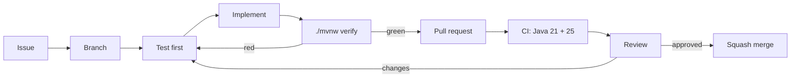

# Development lifecycle

How a change moves from idea to `main`. The same flow applies to people and to AI agents
(agents also follow [AGENTS.md](../AGENTS.md)).



## 1. Plan

- Start from an issue that states the problem (use the templates in `.github/ISSUE_TEMPLATE/`).
- Decide where the change belongs:
  - **Framework** (`src/main`): generic behaviour any API's tests could use. It must not know about the
    example domain.
  - **Domain or tests** (`src/test`): a new API client, model, data factory or test.
- If the change sets a lasting direction (a new dependency, a new extension point, a changed convention),
  write an ADR in `docs/adr/` as part of the same pull request.

## 2. Branch

Branch from `main`: `feat/<topic>`, `fix/<topic>`, `docs/<topic>`, `build/<topic>`, `test/<topic>`.
One topic per branch.

## 3. Test first

- Framework change: write or extend a unit test in `io.github.omarmokhtarsaad.apitest.unit`
  (group `unit`). It must fail before the change.
- New API behaviour: add the WireMock mapping under `src/test/resources/wiremock/` and the API test,
  then make it pass.
- Bug: first reproduce it with a failing test, then fix it.

## 4. Implement

Follow [CODING_STANDARDS.md](CODING_STANDARDS.md). Keep the change small; refactoring goes in its own commit
or pull request.

## 5. Verify locally

```bash
./mvnw -q spotless:apply      # format
./mvnw -B verify              # enforcer, compile, all tests, coverage report
```

`verify` must be green before you push. For a quick loop use `-Dsuite=unit` or `-Dsuite=smoke`.

## 6. Commit

[Conventional Commits](https://www.conventionalcommits.org/): `feat:`, `fix:`, `docs:`, `test:`,
`build:`, `refactor:`, `chore:`. The subject is in the imperative mood and at most 72 characters.
The body explains why. Add an entry to `CHANGELOG.md` under **Unreleased** for anything a user would notice.

## 7. Pull request

Fill in the template. CI runs `./mvnw -B verify` on Java 21 and 25 and uploads Surefire, Allure and
JaCoCo reports as artifacts. A pull request is merged only when:

- CI is green on both Java versions;
- a reviewer has gone through the [review checklist](CODING_STANDARDS.md#review-checklist);
- docs, `CHANGELOG.md` and any ADR are part of the change.

Merge with squash, so `main` has one commit per change.

## 8. Release

The project is a reference framework and is not published to Maven Central. A release is a git tag
`vMAJOR.MINOR.PATCH` (Semantic Versioning) on `main`:

1. Move the **Unreleased** entries in `CHANGELOG.md` under the new version and date.
2. Set the same version in `pom.xml`.
3. Tag and push: `git tag -a v1.2.0 -m "v1.2.0" && git push origin v1.2.0`.

A breaking change to a public framework API, a config key or a suite name is a major version.

## 9. Maintain

- Dependencies: review updates monthly. Bump one library per pull request and read its release notes.
  The enforcer's dependency-convergence rule will fail the build if a bump causes a version conflict;
  resolve it with an explicit pin and a comment. See [ARCHITECTURE.md](ARCHITECTURE.md#dependency-policy).
- Flaky tests: never add retries to hide them. Find the cause (shared state, ordering, timing), fix it,
  and note the fix in the pull request.
